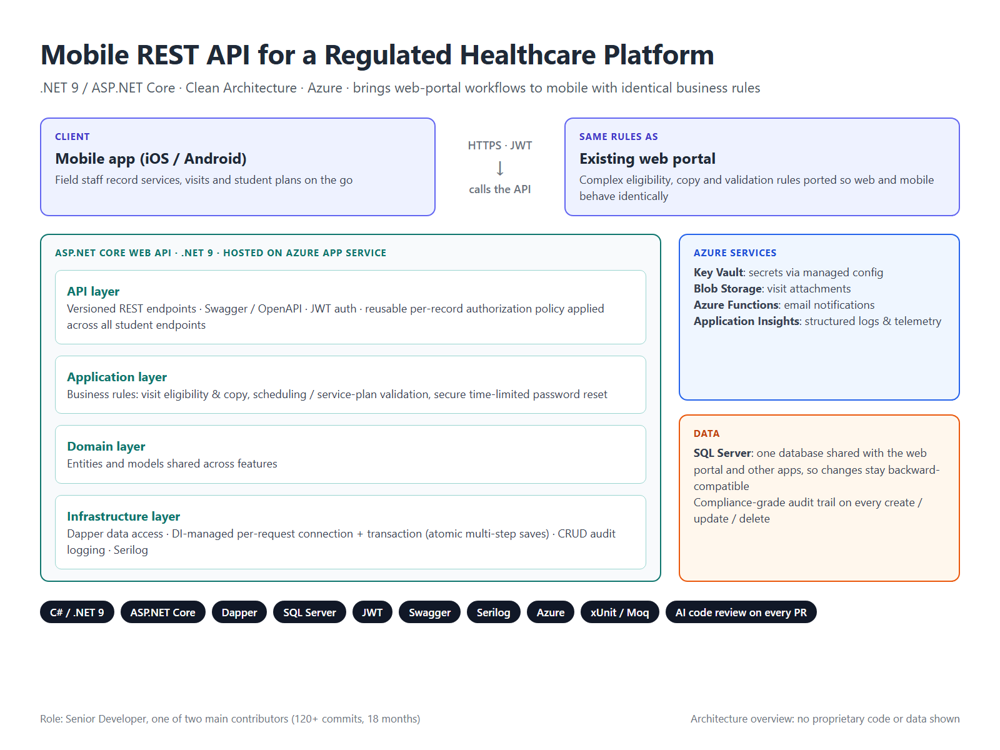

# Mobile REST API for a Regulated Healthcare Platform

**Architecture case study** · .NET 9 / ASP.NET Core · Clean Architecture · Azure

> This is proprietary client work, so this repository contains **no source code or data**:
> only an overview of the problem, the architecture, and my contributions.

## The project

An established healthcare billing and case-management **web platform** needed a **mobile
channel** so field staff could record services, visits and student plans from iOS and Android
devices.

I built the mobile REST API as **one of the two main contributors** (120+ commits over
18 months).

## The challenge

- **Identical behaviour.** The web platform had years of complex business rules (service
  eligibility, scheduling, service-plan validation, copying existing records). Mobile had to
  return exactly the same results as the web.
- **Shared production database.** The API shares one SQL Server database with the web
  portal and other applications, so every change had to stay backward-compatible.
- **Regulated data.** Every read and write had to respect per-record access rights and
  leave a complete, compliance-grade audit trail.

## Architecture

| Layer | Responsibility |
|---|---|
| **API** | Versioned REST endpoints, Swagger / OpenAPI, JWT bearer authentication, reusable authorization policies |
| **Application** | Business rules and use cases, ported from the web platform |
| **Domain** | Entities and models shared across features |
| **Infrastructure** | Dapper data access, DI-managed connections and transactions, audit logging, Azure integrations, Serilog |

Hosted on **Azure App Service**, with **Key Vault** for secrets, **Blob Storage** for
attachments, **Azure Functions** for email notifications, and **Application Insights** for
structured logs and telemetry.

## What I delivered

- **Business-rule parity with the web platform.** I rewrote complex visit eligibility, copy and
  validation logic so the mobile and web channels behave identically.
- **Atomic multi-step saves.** I introduced dependency-injected, per-request database
  connections and transactions, so a multi-table save either fully succeeds or fully rolls back.
- **Per-record authorization.** I designed a reusable authorization policy/attribute that
  enforces a user's access to a specific record, then applied it across every student-related
  endpoint instead of repeating checks in each action.
- **Secure account recovery.** I built a password-reset flow with time-limited reset tokens.
- **Data integrity fixes.** I prevented overlapping records from being created, implemented
  correct cascading deletes for parent/child records, and fixed audit logging so every create,
  update and delete is captured accurately.
- **New feature APIs.** I added endpoints for service records, goals and objectives, visit
  history, plan details and user profile data, extending the API as the mobile app grew.
- **Azure integrations.** I stored attachments in Blob Storage when copying records and
  triggered email notifications through an Azure Function.
- **Quality.** The API has xUnit / Moq unit tests, and every pull request went through
  AI-assisted code review, with each finding either fixed or resolved with a documented reason.

## Tech stack

`C#` · `.NET 9` · `ASP.NET Core Web API` · `Dapper` · `SQL Server` · `JWT` ·
`Swagger / OpenAPI` · `API versioning` · `Serilog` · `Azure App Service` · `Azure Key Vault` ·
`Azure Blob Storage` · `Azure Functions` · `Application Insights` · `xUnit` · `Moq`

## How I work

- **Preserve, then improve:** extend existing systems without breaking what already works.
- **Fix the root cause:** fix the underlying problem, not the symptom, and add guards so
  the same failure explains itself next time.
- **AI-accelerated, human-verified:** I use Claude Code and AI review to move faster, and I
  verify every change before it ships.

---

Interested in similar work? Reach me through my freelance profile.
